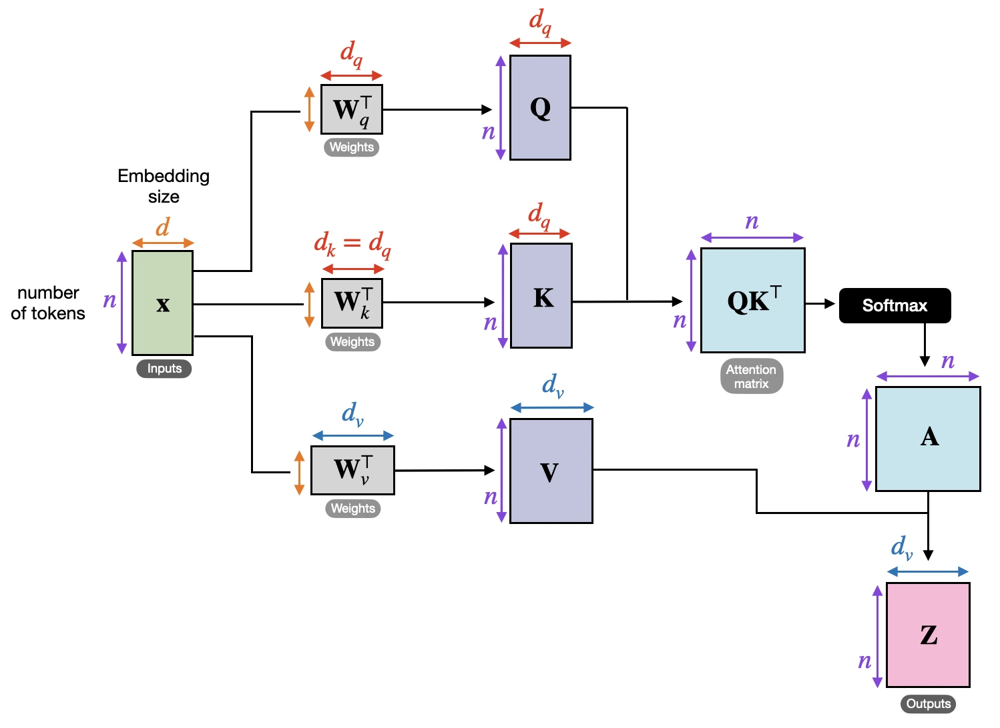

# 20.A04-DeepLearning

## Setup

- If you don't have Anaconda/`conda`/`mamba` installed on your computer (WSL/macOS/Linux), then install Micromamba by running the following command in your terminal:
    ```bash
    # for Linux users
    "${SHELL}" <(curl -L micro.mamba.pm)

    # for macOS users
    brew install micromamba
    ```
- Additionally, [install `uv`](https://docs.astral.sh/uv/getting-started/installation/#homebrew) if you don't have it already:
    ```bash
    # for Linux users
    curl -LsSf https://astral.sh/uv/install.sh | sh

    # for macOS users
    brew install uv
    ```
- The root `pyproject.toml` declares dependencies for both MNIST and addition. Install them by running the following from the project root directory:
    ```bash
    uv sync
    ```

## Math foundations

- [3Blue1Brown's Linear Algebra series](https://www.youtube.com/playlist?list=PLZHQObOWTQDPD3MizzM2xVFitgF8hE_ab)
    - Focus on chapters 3, 4, and 5

## Neural networks, cost functions, gradient descent, and backpropagation

### Notes

1. The "purpose" of deep learning
    - Learning from data
2. Neural networks and architectures
    - **Universal approximation theorem**. Even a single hidden layer feedforward network, given enough width (number of neurons), can represent any continuous function on a compact domain (i.e. any mapping from inputs to outputs).
3. Cost/loss functions
    - Because we are learning a function to map from inputs to outputs, we need a way to inform the network how well or poorly it is performing. This is the purpose of the **cost/loss function**.
    - Typical loss functions used are:
        - **Mean squared error (MSE)**, for continuous regression
        - **Categorical cross-entropy**/negative log-likelihood, for mutually-exclusive multiclass classification
            - Entropy (3Blue1Brown): https://www.youtube.com/watch?v=l6DKRf-fAAM
            - Cross-entropy (understanding categorical cross-entropy loss; 3Blue1Brown): https://www.youtube.com/watch?v=GlYgs6v2YfU
4. Gradient descent
    - Stochastic gradient descent (SGD): a compute-efficient version of gradient that only uses a **minibatch** (subset) of training data to compute the gradient.
        - A side effect of SGD is that it helps escape local minima because of its randomness
5. Backpropagation
    - An efficient algorithm for computing gradients

### References
- https://www.3blue1brown.com/lessons/neural-networks
- https://www.3blue1brown.com/lessons/gradient-descent
- https://www.3blue1brown.com/lessons/neural-network-analysis/
- https://www.3blue1brown.com/lessons/backpropagation/
- https://www.3blue1brown.com/lessons/backpropagation-calculus/

## Feedforward networks

### Background
- What is a neural network?
    - https://www.3blue1brown.com/lessons/neural-networks
    - https://www.3blue1brown.com/lessons/neural-network-analysis/
- Feedforward networks are also called **multilayer perceptrons (MLPs)**.
- Train, validation, and test sets
  - MNIST
    - Training set: 60,000 images
    - Test set: 10,000 images
    - Image dimensions: 28 × 28 pixels (784 pixels)
    - Classes: 10 (digits 0–9)

### Experiment

- See [`mnist/README.md`](./mnist/README.md) for experiment info.

## Convolutional neural networks (CNNs)

### Background

- What is a kernel convolution?
    - How blurs and filters work (Computerphile): https://www.youtube.com/watch?v=C_zFhWdM4ic
    - Sobel edge operator (Computerphile): https://www.youtube.com/watch?v=uihBwtPIBxM
    - Gabor filters (shape and frequency): https://en.wikipedia.org/wiki/Gabor_filter
- What is a convolutional neural network?
    - Convolutional neural networks (Computerphile): https://www.youtube.com/watch?v=py5byOOHZM8
- Transformer circuits for CNNs: https://distill.pub/2020/circuits/zoom-in/

### Experiment

- See [`mnist/README.md`](./mnist/README.md) for experiment info.

## Recurrent neural networks: RNNs and LSTMs

### Background

- Most AI has amnesia. Here's the fix (Artem Kirsanov): https://www.youtube.com/watch?v=PAoe7mmmvp0
- RNN architectures: https://inductive-research.github.io/blog/arch

## Attention and transformers

- 3Blue1Brown
    - DL5 — Transformers: https://www.youtube.com/watch?v=wjZofJX0v4M
    - DL6 — Attention in transformers: https://www.youtube.com/watch?v=eMlx5fFNoYc
    - DL7 — How might LLMs store facts: https://www.youtube.com/watch?v=9-Jl0dxWQs8
- Sebastian Raschka
    - Coding Self-Attention From Scratch: https://sebastianraschka.com/blog/2023/self-attention-from-scratch.html

### Attention



## Flow matching

- How I understand flow matching (Jia-Bin Huang): https://www.youtube.com/watch?v=DDq_pIfHqLs

## Miscellaneous

- [Neural circuit diagrams (Vincent Abbott)](https://arxiv.org/abs/2402.05424)
    - Quick introduction: https://vtabbott.io/articles/diagrams-explained-quickly/
